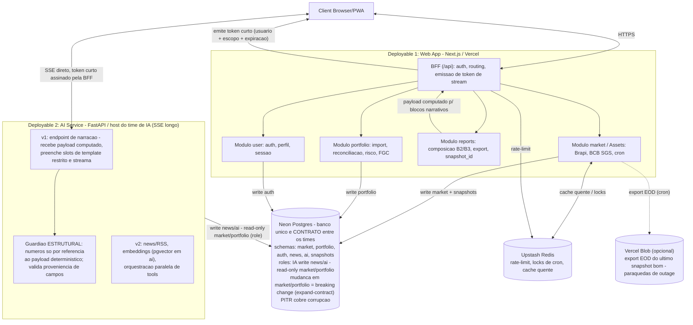

# Bull - README de arquitetura

Este README é o ponto de entrada para a arquitetura alvo da migração. O plano normativo completo está em
[migracao-arquitetura.md](migracao-arquitetura.md).

**Stack final:** Vercel (web) + host do time de IA (escolha deles — qualquer um que rode FastAPI com SSE
de longa duração) + Neon + Upstash. Quatro peças, um banco, contrato explícito entre os times.

## Diagrama canônico

Fonte editável versionada: [diagrams/arquitetura-alvo.mmd](diagrams/arquitetura-alvo.mmd).

Pontos que o diagrama assume conscientemente (ADRs [0007](adrs/0007-banco-unificado-neon-schema-como-contrato.md)
e [0008](adrs/0008-sse-direto-com-token-curto-emitido-pelo-bff.md)):

- **O schema do Neon é o contrato formal entre o time web e o time de IA.** Roles do Postgres são o
  enforcement (IA: write `news`/`ai`, read-only `market`/`portfolio`); mudança em `market`/`portfolio`
  é breaking change e segue expand-contract.
- **SSE vai direto do cliente ao AI Service** com token curto assinado pela BFF — a BFF emite credencial,
  não proxia stream. Sem circuit breaker no MVP: timeout + retry com backoff; estado de breaker, se um
  dia importar, vai para o Upstash.
- **Guardião é estrutural, não filtro pós-hoc**: o LLM preenche slots de template restrito e todo número
  entra por referência ao payload determinístico; o Guardião valida proveniência de campos.
- **Escopo v1 da IA: um endpoint de narração.** News/RSS, embeddings (pgvector no schema `ai`) e
  orquestração de tools são v2.
- **Snapshots têm schema próprio** com `snapshot_id` e staleness rotulada na leitura. PITR cobre
  corrupção; export EOD para Vercel Blob é o pára-quedas opcional contra outage.

## Fluxo de deploy e variáveis de ambiente

Fonte editável versionada: [diagrams/deploy-e-envs.mmd](diagrams/deploy-e-envs.mmd). Tabelas normativas:
[§8.1 e §8.2 do plano](migracao-arquitetura.md#81-fluxo-de-deploy-por-deployable).

```mermaid
flowchart TB
  pr["PR aprovado e mergeado"]

  pr -->|"mudanca em web/** ou docs/contracts/**"| w1
  pr -->|"mudanca no repo bullcapital-ai"| a1

  subgraph web_pipe["Pipeline Web App - Vercel"]
    direction TB
    w1["1. prisma migrate deploy - usa DIRECT_URL, roda antes do app"]
    w2["2. next build + deploy"]
    w3["3. Vercel Cron ativo: /api/cron/quotes em pregao e /api/cron/eod 21:45 UTC"]
    w4["rollback: build anterior no Vercel; schema so avanca - migration corretiva, nunca reset"]
    w1 --> w2 --> w3
    w2 -. "falha" .-> w4
  end

  subgraph ai_pipe["Pipeline AI Service - repo bullcapital-ai (host: escolha do time de IA)"]
    direction TB
    a1["1. Alembic - schemas news/ai, quando existir"]
    a2["2. build Dockerfile + deploy - qualquer host com FastAPI + SSE longo\n(Railway, Render, Fly...)"]
    a3["rollback: versao anterior compativel com o contrato SSE"]
    a1 --> a2
    a2 -. "falha" .-> a3
  end

  contract["Contratos entre os times:\n1. schema do Neon (market/portfolio) - breaking change segue expand-contract\n2. eventos SSE/envelope - produtor emite campos opcionais ANTES\nde consumidor exigir obrigatorios"]
  web_pipe -.-> contract
  ai_pipe -.-> contract

  subgraph vercel_env["Env vars - Vercel (Web)"]
    direction TB
    ev1["DATABASE_URL - Neon pooled (runtime)"]
    ev2["DIRECT_URL - Neon direto (so migrations)"]
    ev3["NEXTAUTH_SECRET + NEXTAUTH_URL"]
    ev4["ANALYSIS_API_URL (server-to-server)\nNEXT_PUBLIC_ORCHESTRATOR_URL (SSE direto do browser)\nAPI_SHARED_SECRET (assina token curto de stream)"]
    ev5["BRAPI_KEY (ingestao) + CRON_SECRET (protege /api/cron/*)"]
    ev6["F4+: UPSTASH_REDIS_REST_URL / TOKEN"]
    ev7["opcional: BLOB_READ_WRITE_TOKEN (export EOD p/ Vercel Blob)"]
  end

  subgraph ai_env["Env vars - host da IA"]
    direction TB
    ea1["DATABASE_URL - role escopada (ADR 0007):\nwrite news/ai - read-only market/portfolio"]
    ea2["OPENAI_API_KEY / OPENROUTER_API_KEY / OPENROUTER_MODEL"]
    ea3["API_SHARED_SECRET - mesmo valor do web (valida token de stream)"]
    ea4["CORS_ORIGINS (dominio do app - SSE direto) + DATABASE_SSL + LOG_LEVEL"]
    ea5["MARKET_SCHEDULERS_ENABLED=false apos handoff F3"]
  end

  web_pipe --- vercel_env
  ai_pipe --- ai_env

  neon[("Neon - banco unico\n(market, portfolio, auth, news, ai, snapshots)")]
  upstash[("Upstash - Redis")]
  blob[("Vercel Blob - export EOD opcional")]

  ev1 --> neon
  ev2 --> neon
  ea1 --> neon
  ev6 --> upstash
  ev7 --> blob
  ev4 -. "token curto: BFF assina, IA valida" .- ea3
```

Regras que o diagrama resume: cada deployable mantém exatamente um `.env.example` versionado que bate
com a tabela §8.2; nova env var só passa em PR se tabela e exemplo mudarem juntos; o Upstash nunca é
pré-requisito para servir snapshot; migrate antes do app via `DIRECT_URL`, expand-contract, rollback de
build sem rollback de schema — com dois times num banco só, essa disciplina é o que impede um time de
quebrar o outro.

## Documentos normativos

- [Plano de migração](migracao-arquitetura.md) - destino, ordem de build e critérios de aceite.
- [Contrato BFF ↔ AI via SSE](contracts/bff-ai-sse.md) - transporte, eventos, timeout e falhas.
- [Envelope de provenance](contracts/data-envelope.md) - `source`, `ts`, `stale` e semântica de fallback.
- [ADRs](adrs/) - decisões arquiteturais que não devem ser simplificadas sem nova decisão registrada.

## Critério de fechamento

Marco D só fecha quando os critérios da seção
[0.1 do plano de migração](migracao-arquitetura.md#01-critérios-de-aceite-da-migração) estiverem verdes:
documento de arquitetura, fluxo de deploy, setup local e ADRs.
