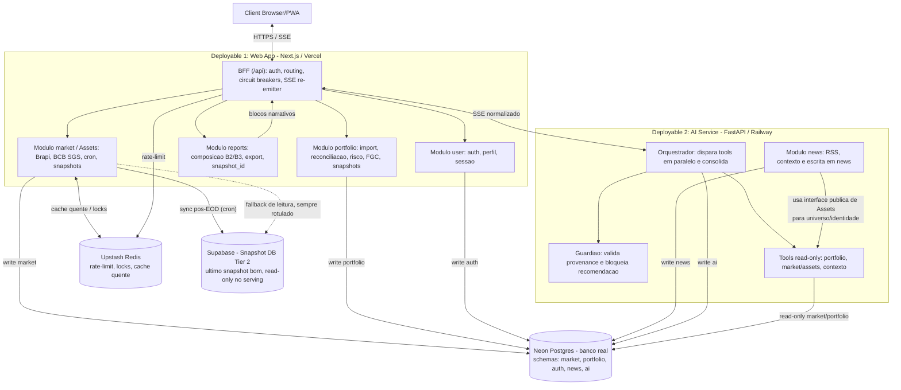

# Bull - README de arquitetura

Este README é o ponto de entrada para a arquitetura alvo da migração. O plano normativo completo está em
[migracao-arquitetura.md](migracao-arquitetura.md).

## Diagrama canônico

Fonte editável versionada: [diagrams/arquitetura-alvo.mmd](diagrams/arquitetura-alvo.mmd).

## Documentos normativos

- [Plano de migração](migracao-arquitetura.md) - destino, ordem de build e critérios de aceite.
- [Contrato BFF ↔ AI via SSE](contracts/bff-ai-sse.md) - transporte, eventos, timeout e falhas.
- [Envelope de provenance](contracts/data-envelope.md) - `source`, `ts`, `stale` e semântica de fallback.
- [ADRs](adrs/) - decisões arquiteturais que não devem ser simplificadas sem nova decisão registrada.

## Critério de fechamento

Marco D só fecha quando os critérios da seção
[0.1 do plano de migração](migracao-arquitetura.md#01-critérios-de-aceite-da-migração) estiverem verdes:
documento de arquitetura, fluxo de deploy, setup local e ADRs.
